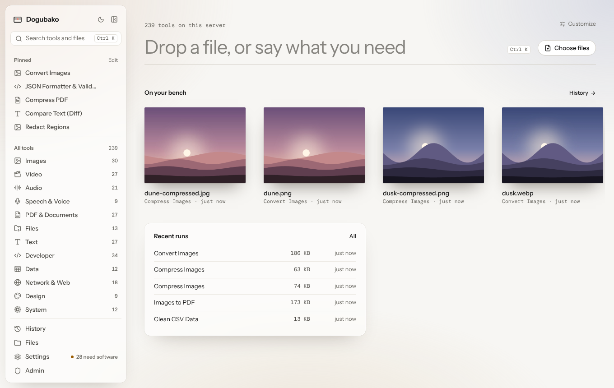
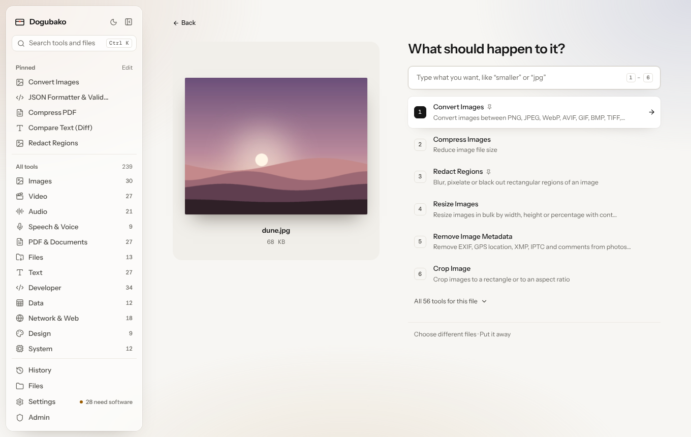
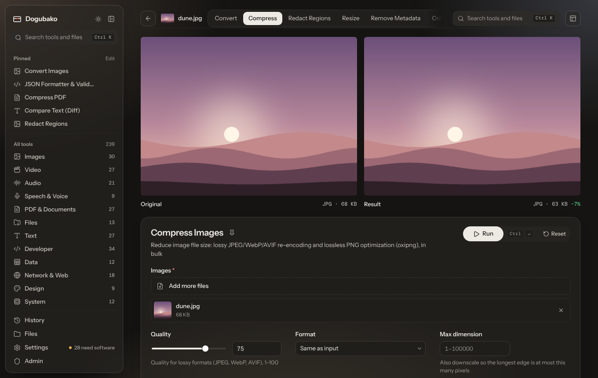
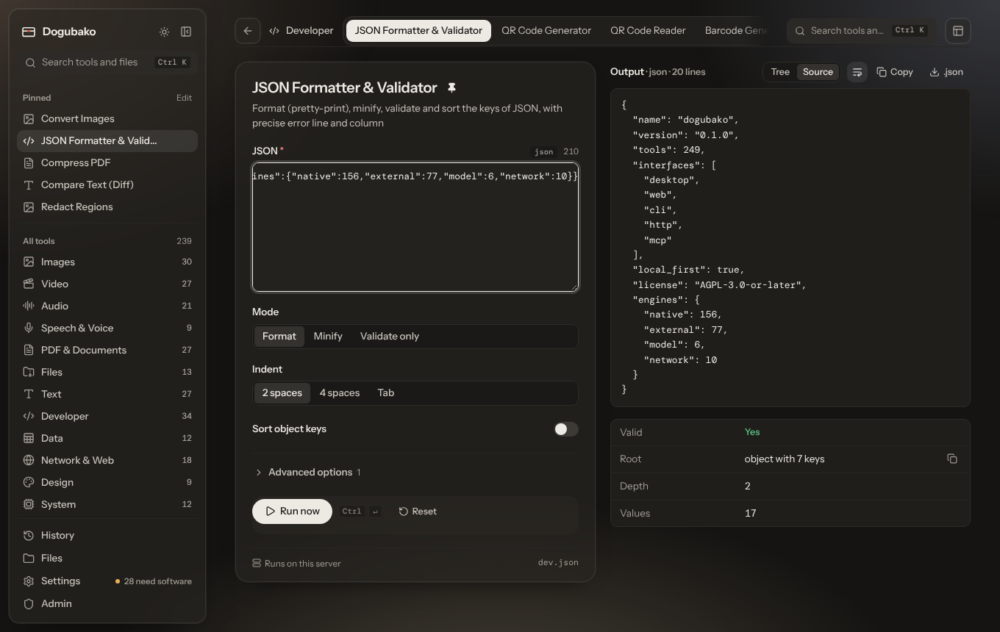

<p align="center"></p>

<h1 align="center">Dogubako</h1>

<p align="center"><b>道具箱 — a local-first, open-source utility toolbox.</b><br>
249 tools for images, video, audio, speech, PDFs, files, text, developers, data, networks, design and system info —<br>
as a desktop app, a self-hosted web service, a CLI, an HTTP API and an MCP server.</p>

---

Dogubako replaces the dozens of single-purpose utility websites and small apps
you reach for every week. Open it, find the tool (⌘K), drop in a file, done.
Nothing leaves your machine unless you host it yourself.

* **Free and open source** (AGPL-3.0-or-later). No accounts for desktop use, no telemetry, no paywalls.
* **Built on mature open-source engines** — FFmpeg, ImageMagick, libvips, ExifTool, qpdf, Poppler, Ghostscript, Tesseract, whisper.cpp, Piper, LibreOffice, Pandoc, 7-Zip — plus fast native Rust implementations for everything that doesn't need them.
* **One implementation, every interface.** Each tool is a declarative spec + one function; the UI, CLI, HTTP API, OpenAPI document and MCP tools are all generated from it and executed by the same engine.
* **Agent-ready, not agent-first.** Run a central server with all the heavy dependencies and give each AI agent its own scoped token: an image bot may resize and blur; a media bot may transcode and transcribe; neither can touch the other's files or your system tools.
* **Secure by construction.** No shell is ever used; external programs run with timeouts, resource limits and optional bubblewrap sandboxing; files are id-addressed and owner-checked; network tools are SSRF-guarded; everything is audit-logged.

## Screenshots

<p align="center">
  
  
  
  
</p>

More in [docs/screenshots](docs/screenshots).

## What's inside

| Category | Tools | Highlights |
|---|---:|---|
| Images | 30 | convert (HEIC/AVIF/WebP/…), batch resize/compress, crop, watermark, metadata inspect/strip, compare (SSIM/PSNR), contact & sprite sheets, SVG → PNG, SVG optimize, icons & favicon packs, face detect/blur with manual correction, redact regions, OCR, background removal, upscaling |
| Video | 27 | convert/compress (incl. target size, hardware encoders), trim/cut/merge, crop/rotate, GIF ⇄ video, speed, stabilize, frames & thumbnails, previews, subtitles add/burn/extract, inspect |
| Audio | 21 | convert, EBU R128 normalize, trim/split/merge, silence detect/remove, waveform & spectrogram, tags & cover art, denoise, EQ, speed, fades |
| Speech | 9 | offline transcription (whisper.cpp) to TXT/SRT/VTT/JSON/MD, language detection, speaker turns, VAD segmentation, TTS (Piper), subtitle convert/shift |
| PDF & documents | 27 | merge/split/reorder/rotate, compress, OCR to searchable PDF, text & image extraction, PDF ⇄ images, watermark, page numbers, metadata, encrypt/decrypt, forms, Office/Markdown conversion |
| Files | 23 | hashes & checksum verify, archives (zip/tar/7z/… with bomb & traversal protection), duplicates, large files, folder compare, batch rename with preview, type detection, binary inspection |
| Text | 27 | case, counts, sort/dedupe, diff, regex replace, encodings, escaping, Markdown → HTML, HTML → text/Markdown, extraction from Office/EPUB/PDF |
| Developer | 34 | JSON/YAML/TOML/XML format & convert, Base64/URL/hex, UUID, secure random & passphrases, hashes & HMAC, timestamps & time zones, regex tester, JSONPath & jq, JWT decode/verify, SQL format, cron, QR & barcodes |
| Data | 12 | CSV view/filter/sort/stats/dedupe/clean, spreadsheets (XLSX/ODS), JSON ⇄ CSV, schema validation, export to XLSX/SQL/Markdown |
| Network | 18 | DNS, RDAP/WHOIS, HTTP header & security audit, TLS certificate inspection, cert/key decode, URL tools, CIDR & subnet planning, favicon fetch, connectivity |
| Design | 9 | palettes, palette extraction, WCAG contrast, gradients, canvas resize, compose, QR styling |
| System | 12 | overview dashboard, CPU, memory, disks, battery health & cycles, hardware, OS, processes, temperatures, diagnostics |

The full, generated list with dependencies and platforms is in
[docs/CAPABILITIES.md](docs/CAPABILITIES.md) (`dogubako tools matrix`).

## Quick start

### Desktop (macOS, Windows, Linux)

Download the installer from Releases, or build it (see [docs/BUILD.md](docs/BUILD.md)):

```sh
cd web && npm ci && npm run build && cd ..
cd apps/desktop/src-tauri && cargo tauri build
```

Install whichever engines you need (`dogubako deps` or **Settings → Dependencies** shows exact commands):
`brew install ffmpeg qpdf poppler tesseract exiftool` · `sudo apt install ffmpeg qpdf poppler-utils tesseract-ocr libimage-exiftool-perl` · `winget install Gyan.FFmpeg QPDF.QPDF`.

### CLI

```sh
cargo install --path crates/cli          # provides `dogubako`
dogubako tools search pdf
dogubako image convert photo.heic --format webp
dogubako video compress talk.mov
dogubako pdf merge a.pdf b.pdf -o merged.pdf
echo '{"b":1}' | dogubako dev json
```

See [docs/CLI.md](docs/CLI.md).

### Self-hosted (Docker)

```sh
docker compose up -d --build
docker compose logs dogubako | grep "Setup token"     # first-run token
open http://localhost:8420
```

LAN, Tailscale, reverse proxies, configuration and native installs: [docs/SELF_HOSTING.md](docs/SELF_HOSTING.md).

### For AI agents (MCP)

```sh
# local agent, stdio
claude mcp add dogubako -- dogubako mcp serve --discovery compact
# shared server, per-agent token
dogubako users create media-bot --role agent --allow 'video.*' --allow 'speech.*'
dogubako tokens create --user media-bot --name laptop
claude mcp add --transport http dogubako https://tools.example.ts.net/mcp --header "Authorization: Bearer dgb_…"
```

See [docs/MCP.md](docs/MCP.md) and [docs/API.md](docs/API.md).

## Documentation

| | |
|---|---|
| [Architecture](docs/ARCHITECTURE.md) | Crates, execution flow, one-implementation design |
| [Build](docs/BUILD.md) | Building the server, CLI, web UI and desktop app |
| [Self-hosting](docs/SELF_HOSTING.md) | Docker, Tailscale, configuration reference, accounts & agents |
| [CLI](docs/CLI.md) | Commands, conventions, exit codes |
| [HTTP API](docs/API.md) | Endpoints and flow; OpenAPI generated at `/api/v1/openapi.json` |
| [MCP](docs/MCP.md) | Transports, scalable discovery, client setup |
| [Tool development](docs/TOOL_DEVELOPMENT.md) | Writing Rust tools and TOML extensions |
| [Security](docs/SECURITY.md) | Threat model and protections |
| [Dependencies & licensing](docs/DEPENDENCIES.md) | Crates, external programs, models |
| [Capabilities](docs/CAPABILITIES.md) | Generated tool × platform × dependency matrix |
| [Performance](docs/PERFORMANCE.md) | Measured numbers |

## Repository layout

```
crates/core          engine: specs, registry, validation, safe exec, policies, models, extensions
crates/tools-*       tool implementations (image, media, docs, files, text, net, system)
crates/tools         aggregates builtins + trusted extensions
crates/mcp           MCP protocol (transport-agnostic)
crates/server        self-hosted service (axum, SQLite, auth, jobs, storage, MCP HTTP)
crates/cli           `dogubako` binary
apps/desktop         Tauri 2 desktop app
web                  React + TypeScript UI (shared by desktop and web)
extensions           example TOML extension
deploy               compose overlays, systemd unit, example config
website              the dogubako.app website (static, no build step)
docs                 documentation
```

## License

Dogubako is free software under the [GNU AGPL v3.0 or later](LICENSE).
Third-party components keep their own licenses; see [docs/DEPENDENCIES.md](docs/DEPENDENCIES.md).
