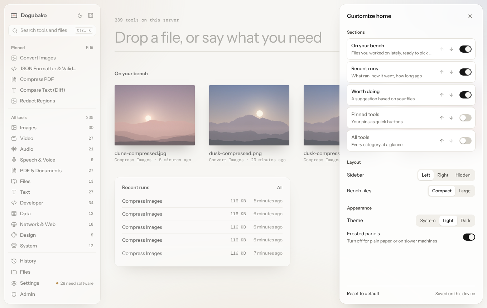

Dogubako has a pretty default and a few curated options. All of these are
saved per device (in the desktop app, or in the browser you use), so your
phone and your laptop can be set up differently.

## Customize home

Click **Customize** next to the big input on Home.

**Sections.** Turn each section on or off and move it up or down:

| Section | Shows | Default |
|---|---|---|
| On your bench | Files you worked on lately, ready to pick up | On |
| Recent runs | What ran, how it went, how long ago | On |
| Worth doing | A suggestion based on your files | On |
| Pinned tools | Your pins as quick buttons | Off |
| All tools | Every category at a glance | Off |

**Layout.**

- **Sidebar:** **Left** (default), **Right** or **Hidden**. You can also hide
  and show it at any time with <kbd>⌘</kbd> <kbd>\\</kbd>
  (<kbd>Ctrl</kbd> <kbd>\\</kbd>).
- **Bench files:** **Compact** (default) or **Large**.

**Appearance.**

- **Theme:** **System** (default), **Light** or **Dark**.
- **Frosted panels:** on by default. Turn it off for plain paper, or on slower
  machines.

## Pinning tools

Pin a tool with the pin button next to its name on the tool page, or with the
pin toggles in the Tools menu (<kbd>T</kbd>). Pinned tools:

- appear at the top of the sidebar,
- open with <kbd>Alt</kbd> <kbd>1</kbd> to <kbd>Alt</kbd> <kbd>9</kbd> in
  pin order,
- are nudged up in suggestions on the drop screen,
- can be shown on Home and in the tool row.

## Tool page layout

The **Layout** menu on any tool page sets where the controls go, how the
preview looks, what the tool row shows and what the next tool works on. See
[The tool page](/app/tool-page/#layout).

## Settings

**Settings → General** has:

| Setting | What it does |
|---|---|
| Theme | Follow your system, or pick light or dark |
| Density | Compact shows more tools per screen |
| Remember tool options | Restore each tool's last settings (never files or secrets) |
| Keep run history | Store a local list of past runs on this device (desktop) |
| Data on this device | Clear your pinned tools (listed as **Favorites**), recently used tools and remembered options |

The other sections are **Dependencies** and **Models** (see
[Engines and models](/app/engines-and-models/)) and **About**, with the
version, license and links to the API and source code.
