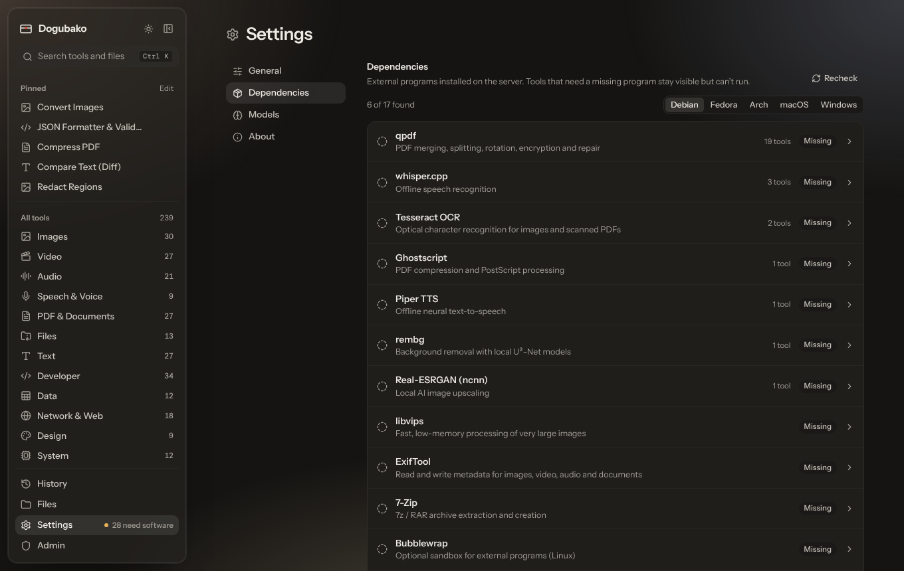

The desktop app is a [Tauri 2](https://tauri.app) shell around the same web
interface. It calls the engine **in-process**: there is no HTTP server, no
open port and no background service. When the window is closed, nothing of
Dogubako is running.

## What's different from the web app

| | Desktop app | Self-hosted web app |
|---|---|---|
| Where tools run | On this computer | On the server |
| Accounts | None | Required (owner, admins, users, agents) |
| File inputs | Local paths; drag files from your file manager | Uploaded to the server, addressed by id |
| Outputs | Written to the outputs folder; **Save…** copies them anywhere | Downloaded from the server; expire after the retention period |
| History | Stored on this device (can be turned off) | Stored per account on the server |
| Pages | No Files, Account or Admin pages | Files, Account and (for admins) Admin |
| Permissions | You are trusted like your own shell | Granted per account and token |

## Where files go

Dogubako keeps its data in one per-user folder:

| System | Folder |
|---|---|
| macOS | `~/Library/Application Support/Dogubako` |
| Windows | `%APPDATA%\Dogubako` |
| Linux | `$XDG_DATA_HOME/dogubako`, usually `~/.local/share/dogubako` |

Inside it:

| Path | Holds |
|---|---|
| `outputs/<run id>/` | The output files of each run |
| `models/` | Downloaded models |
| `extensions/` | Your [extension](/develop/extensions/) manifests and `trusted.toml` |
| `bin/` | Engine binaries you want Dogubako to prefer over your `PATH` |

Set `DOGUBAKO_HOME` to use a different folder. Files you paste or drag in from
a web page (which have no path on disk) are staged in your system's temporary
folder.

## How it finds engines

For each engine, Dogubako looks in this order:

1. the path in `DOGUBAKO_<ID>_PATH`, for example `DOGUBAKO_FFMPEG_PATH`;
2. the `bin/` folder above;
3. your `PATH`.

**Settings → Dependencies** shows what was found, the version, and the
install command for your system.



:::caution[macOS and Homebrew]
Apps opened from the Dock or Finder on macOS get a minimal `PATH` that does
not include Homebrew (`/opt/homebrew/bin` or `/usr/local/bin`). If
Dependencies says an engine is missing even though `brew` installed it, link
it into Dogubako's `bin` folder:

```sh
BIN="$HOME/Library/Application Support/Dogubako/bin"
BREW="$(brew --prefix)/bin"
mkdir -p "$BIN"
for p in ffmpeg ffprobe magick vips exiftool qpdf gs tesseract whisper-cli pandoc 7zz "$BREW"/pdf*; do
  p="$(basename "$p")"
  [ -x "$BREW/$p" ] && ln -sf "$BREW/$p" "$BIN/$p"
done
```

Link all of Poppler's `pdf*` programs, as the loop does: Dogubako looks for
them next to `pdftoppm`.

Then restart Dogubako.
:::

## Drag and drop

Drag files from your file manager onto a file field to fill it, or anywhere
else in the window to open the [drop screen](/app/opening-files/). Dropped
files are used in place; Dogubako never modifies its inputs unless a tool
explicitly says it will (such as batch rename with **apply**).

## Privacy

The desktop app sends nothing anywhere. The only network traffic comes from
tools whose job is the network (DNS lookups, HTTP header checks and so on)
and from model downloads you start yourself.
