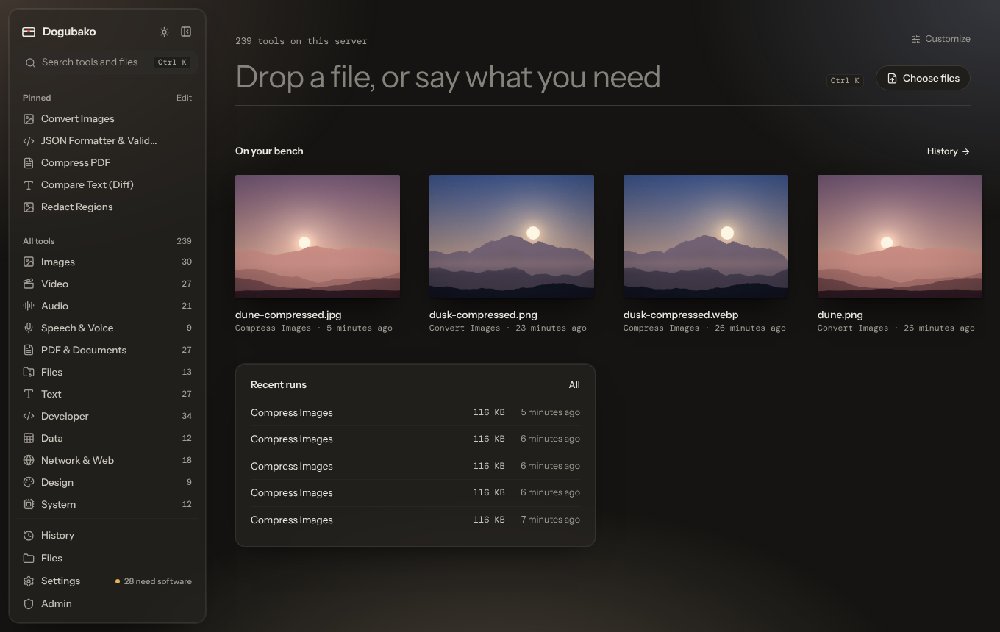

Home is where you start anything. Everything on it can be rearranged or
turned off in [Customize home](/app/customize/).

## The big input

The input at the top shows how many tools are available and where they run
("on this device" in the desktop app, or on your server). It is three things
at once:

- **Type** what you need, such as `merge pdf` or `uuid`, and the search opens
  with what you typed.
- **Drop a file** on it, or anywhere on the window, to go to the
  [drop screen](/app/opening-files/).
- Click **Choose files** to pick files with your system's file dialog.

## On your bench

The bench is a shelf of the files you worked on lately: the outputs of your
recent runs. Each file is drawn as the thing it is, so a photo shows its
picture, a PDF looks like a page, audio shows a waveform, a spreadsheet looks
like a grid and an archive looks like a box. The name, size and how long ago
it was made are underneath.

Click a file on the bench to open it on the drop screen and keep going, for
example to compress the image you just cropped. Bench files come from your
run history, so on a server they disappear when their retention period ends
(24 hours by default).

You can choose **Compact** or **Large** bench files in Customize home.

## Recent runs

The last few runs, with how they went and how long ago. **All** opens
[History](/app/results/#history), where you can reopen any run with the same
settings.

## Worth doing

A suggestion based on what is on your bench, with a button that opens the
right tool. For example:

- a PDF over 3 MB: compress it so it is small enough to email;
- a video over 50 MB: make a compressed copy that is easier to share;
- a HEIC photo: convert it to JPEG or WebP, since some apps can't open HEIC;
- an audio file: transcribe it into text you can search and quote.

The section only appears when there is something worth suggesting, and only
suggests tools you can actually run.

## Pinned tools and All tools

Two optional sections:

- **Pinned tools** shows your pins as quick buttons. **Edit** opens the list
  of pinned tools.
- **All tools** shows every category with its tool count.

Both are off by default; turn them on in [Customize home](/app/customize/).
