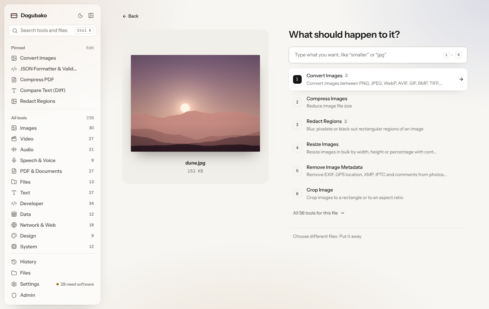

You don't need to know which tool you want. Give Dogubako the file and it
asks what should happen to it.

## Three ways to bring files in

- **Drop** one or more files anywhere on the window. An overlay shows where
  they will go.
- Click **Choose files** on Home to use the system file dialog.
- Click a file **on your bench** to keep working on a recent output.

If you drop a file onto a specific file field on a tool page, it goes
straight into that field instead. In the desktop app, files dropped from your
file manager that no field takes open the drop screen.

## "What should happen to it?"

The drop screen shows the file (or the files) on the left and a short list of
tools on the right:

- **Only tools that take every file you dropped** are offered. Drop three PDFs
  and you'll see merging; drop a PDF and a photo and you'll only see tools that
  accept both.
- **The likeliest actions come first**, chosen for the kind of file. For a
  photo that means compress, convert, resize, strip metadata, crop and so on;
  for a PDF, compress, merge, split, to images and extract text. Your pinned
  and recently used tools are nudged up.
- The top nine are **numbered**. Press <kbd>1</kbd>–<kbd>9</kbd> to open one.
- Use <kbd>↑</kbd> <kbd>↓</kbd> and <kbd>Enter</kbd> to choose, and
  <kbd>Esc</kbd> to clear what you typed or go back.
- **All tools for this file** expands the full list.
- Tools whose engine isn't installed are still listed, marked
  "Needs software that isn't installed", so you can see what is possible.

## Say it in plain words

Type what you want in the box. Besides tool names, it understands everyday
words:

| You type | You get |
|---|---|
| `smaller`, `shrink`, `email`, `web` | compress, resize, convert |
| `jpg`, `png`, `webp`, `mp3`, `mp4`… | the converters |
| `gif` | video to GIF and conversion |
| `text`, `words`, `transcript` | OCR, transcription, text extraction |
| `location`, `gps`, `privacy` | strip metadata, redact, face blur |
| `blur`, `hide`, `faces` | redaction and face blur |
| `background` | background removal |
| `combine`, `join`, `together` | merge |
| `separate`, `pages` | split, extract pages, reorder |
| `turn` | rotate |
| `cut`, `shorter` | trim, cut, crop |
| `bigger`, `sharper` | upscale, resize |
| `password`, `lock`, `unlock` | protect and unlock |
| `quieter`, `louder` | volume and normalize |

## What happens next

The tool you pick opens with your files already filled in. Run it, and the
result appears beside the original on the [tool page](/app/tool-page/).
