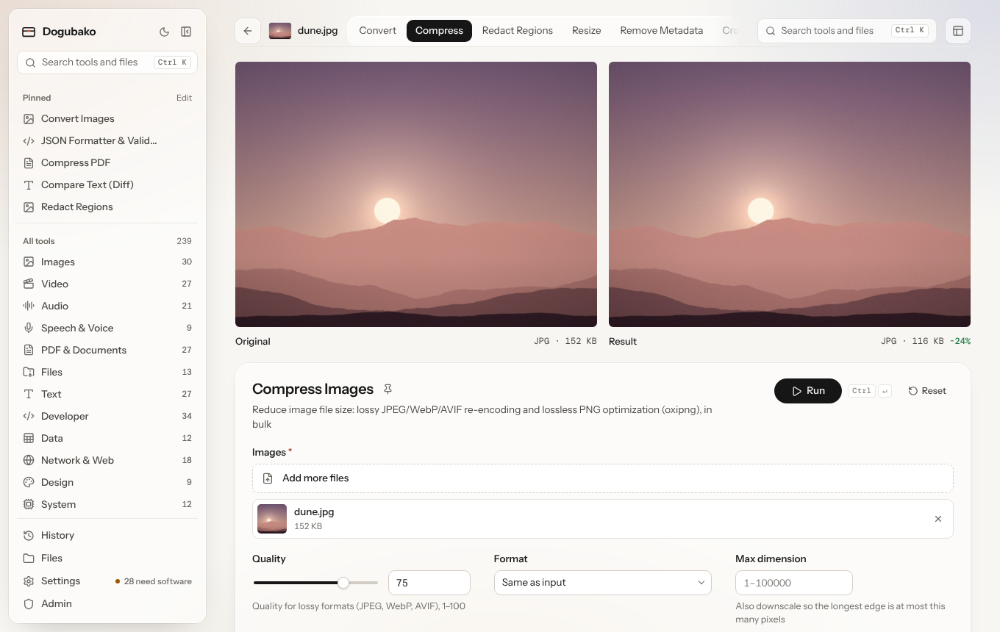
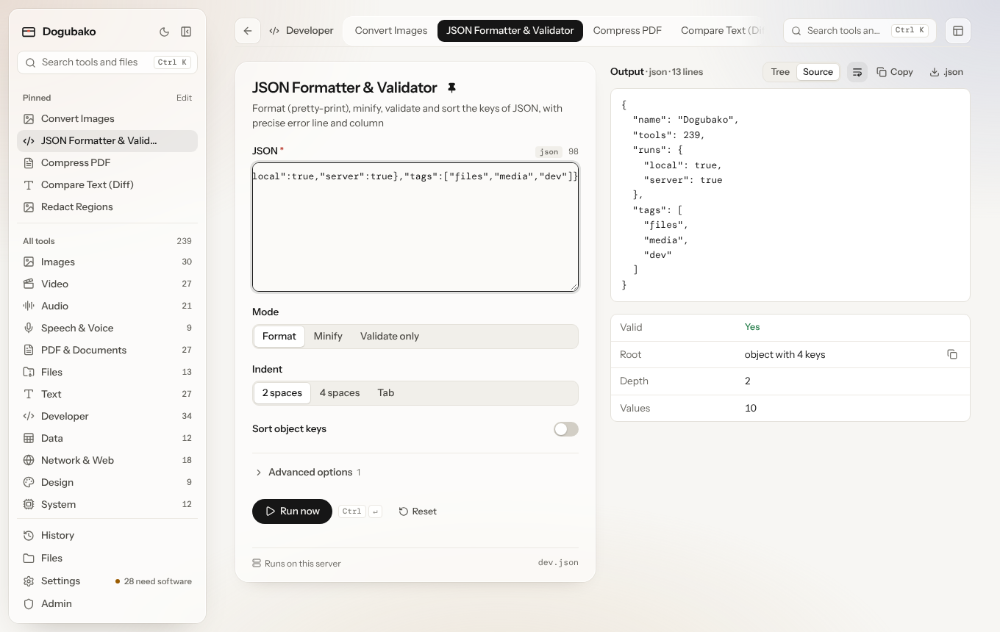
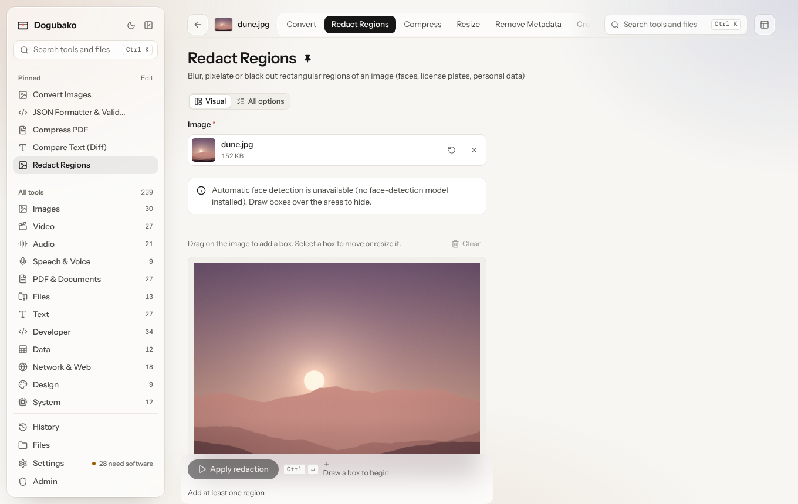

Every tool opens on the same kind of page, built from the tool's spec. A few
tools add a visual editor on top.

## The tool row

The row across the top holds:

- **Back**, to where you came from.
- The **file chip**: the file you are working on. Hover it to see every file
  name when there are several.
- **Tabs for the file's other tools.** Jump from Compress to Convert to Strip
  metadata without starting over. The next tool receives the result of this
  one, or the original if you prefer (see [Layout](#layout)). The last tab
  lists every tool for the file. A tool that takes no file (a generator or a
  formatter, say) shows the other tools in its category instead, pinned ones
  first.
- **Search** and the **Layout** menu.

## The stage

When a tool works on a file, the stage shows **the original and the result
side by side**, with how much the size changed.
Images, video, audio and PDFs preview inline. Switch to **Result only** in
the Layout menu if you want more room.

## Settings

Below the stage (or beside it) is the settings panel:

- The tool's name, a **pin** button, and a one-line description.
- Where it runs: **Runs on this device** in the desktop app, or **Runs on
  this server** when you use a self-hosted instance.
- The tool id, such as `image.compress`, which is the same in the
  [CLI](/cli/overview/), [API](/reference/http-api/) and
  [MCP](/agents/overview/).
- The form. Common options come first; rarer ones are under **Advanced
  options**, which shows how many there are and how many you changed. Some
  options only appear when another option makes them relevant.
- **Run** (<kbd>⌘</kbd> <kbd>Enter</kbd> or <kbd>Ctrl</kbd> <kbd>Enter</kbd>).
  Long jobs show progress and can be cancelled.

If the tool needs an engine or model that isn't installed, a notice at the top
says which one and gives the install command to copy. If it doesn't run on
your operating system at all, the notice says so.

Turn on **Remember tool options** in Settings to restore each tool's last
settings next time. Files and secrets are never remembered.

## Live tools

Fast text and developer tools, such as the JSON formatter, case converter or
Base64 encoder, are **live**: they re-run as you type, with the output beside
the input. Live runs are not added to your history. **Run now** forces a run.

## Special editors

Some tools have a purpose-built interface:

| Tool | Editor |
|---|---|
| Face blur and image redaction | Boxes over the image that you can draw, move and delete; detected faces are filled in for you to correct |
| Crop | Drag a crop box over the image |
| Regex tester | Matches highlighted in the text as you type, with groups |
| QR codes | A live preview of the code while you change its settings |
| Color tools | Live swatches as you pick colors |
| Diff tools | Two inputs side by side and the rendered difference; text re-runs live |
| System dashboard | Auto-refreshing CPU, memory, disk and battery panels |

The crop and redaction editors use the same layout as every other tool: the
image you edit is the stage, the settings sit in the panel beside or below
it, and the result appears underneath. Switch between **Visual** and
**All options** to see the full form.

## Layout

The **Layout** menu on the tool row changes how every tool page is arranged.
It is saved on this device.

| Setting | Options |
|---|---|
| Controls | **Below** (default), **Left** or **Right** of the stage |
| Preview | **Side by side** (default) or **Result only** |
| Tool row shows | **Tools for the file** (default) or **Pinned tools** |
| Next tool works on | **The result** (default) or **The original** |
