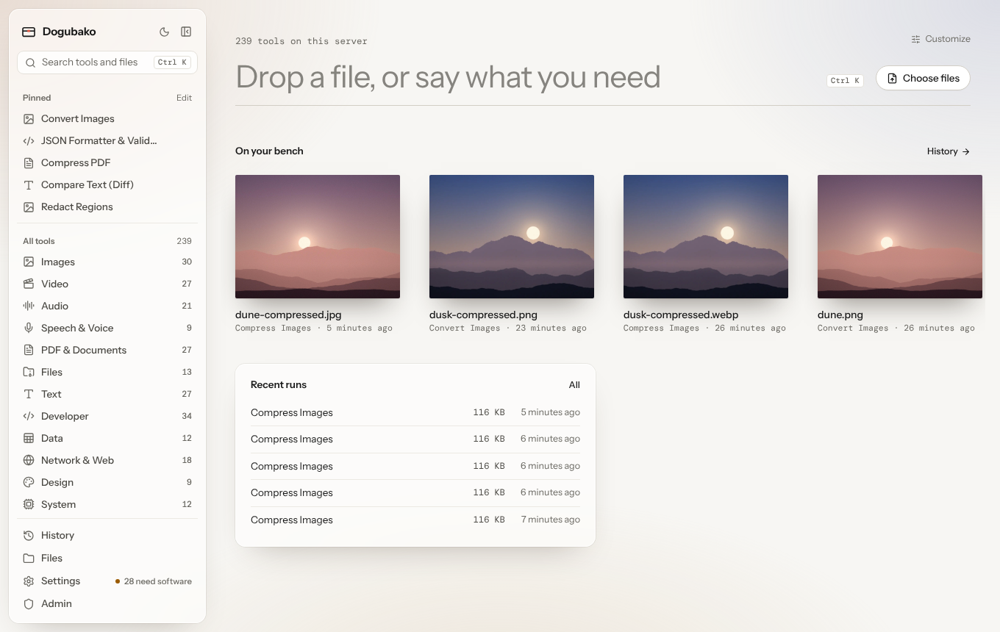
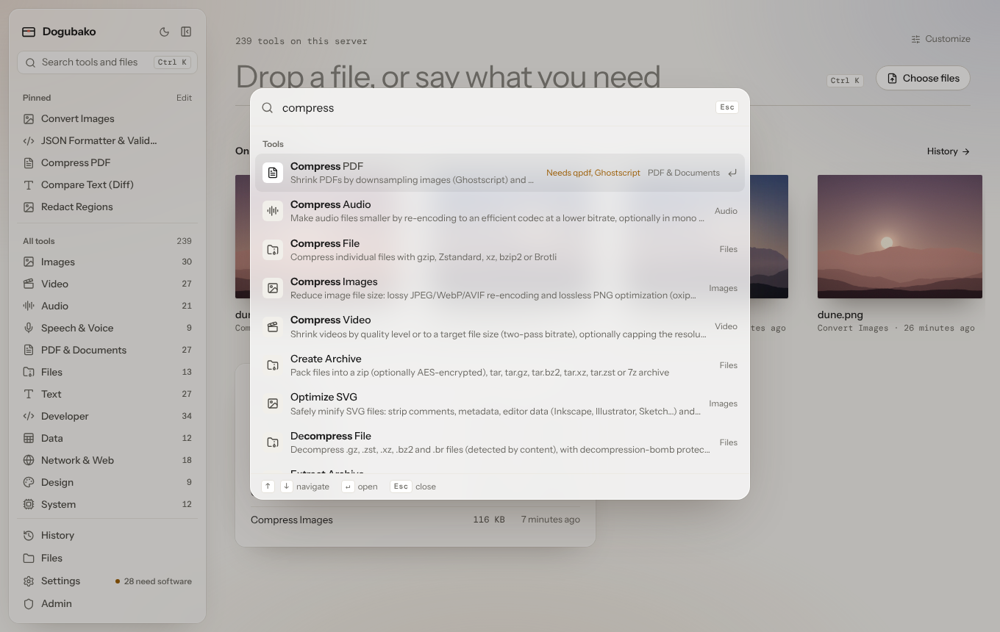
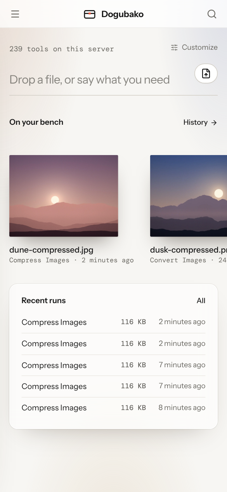

The Dogubako app is one codebase that runs in three places: the desktop app,
a browser pointed at your own server, and phone browsers. The screens are the
same everywhere; the few differences are listed in
[Desktop app](/app/desktop/) and [Self-hosting](/self-hosting/overview/).

The design idea is simple: **files are things on a bench**. You put a file
down, say what should happen to it, and pick up the result. Minimal where it
can be, but never at the cost of a feature.

## The screens

| Screen | What it is for | Details |
|---|---|---|
| **Home** | Start anything: type, drop or choose files, pick up recent work | [Home and the bench](/app/home-and-bench/) |
| **Drop screen** | "What should happen to it?" after you drop or choose files | [Opening files](/app/opening-files/) |
| **Tool page** | Settings, the original and the result side by side | [The tool page](/app/tool-page/) |
| **Results** | Previews, tables, diffs, downloads and next steps | [Results](/app/results/) |
| **History** | Every run on this device or account, with its settings | [Results](/app/results/#history) |
| **Settings** | Theme, density, behavior, dependencies, models | [Customize](/app/customize/), [Engines and models](/app/engines-and-models/) |
| **Files** (server) | Your uploads and outputs, with storage use | [Results](/app/results/#files-on-a-server) |
| **Account** (server) | Password and your own API tokens | [Accounts and agents](/self-hosting/accounts-and-agents/) |
| **Admin** (server) | Users and agents, tokens, audit log, instance, API | [Accounts and agents](/self-hosting/accounts-and-agents/) |

## Finding a tool

There are four ways in, so use whichever is closest:

- **Search.** Press <kbd>⌘</kbd> <kbd>K</kbd> (<kbd>Ctrl</kbd> <kbd>K</kbd> on
  Windows and Linux) or <kbd>/</kbd> and type. Search understands tool names,
  descriptions, keywords and ids.
- **Tools menu.** Press <kbd>T</kbd> to open the Tools menu, browse by
  category, and pin the tools you use most.
- **Drop a file.** Drop it anywhere and Dogubako suggests the tools that take
  it, likeliest first.
- **Pinned tools.** Pinned tools open with <kbd>Alt</kbd> <kbd>1</kbd> to
  <kbd>Alt</kbd> <kbd>9</kbd>, and can sit on Home as quick buttons.

## The sidebar is optional

The sidebar lists your pinned tools and every category. Hide it with
<kbd>⌘</kbd> <kbd>\\</kbd> (<kbd>Ctrl</kbd> <kbd>\\</kbd>). When it is hidden, a
compact bar keeps **Tools**, **Search** and **History** within reach. You can
also move the sidebar to the right, or hide it for good, in
[Customize home](/app/customize/).

## Light, dark and phones

The app follows your system theme, or you can pick one. Frosted glass is used
only on floating surfaces such as menus and panels, and falls back to solid
paper when blur isn't available or you've asked your system for less
transparency.

On a phone, the sidebar becomes a drawer behind the menu button, and every
tool works with touch.

